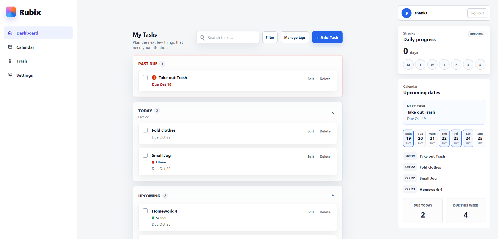
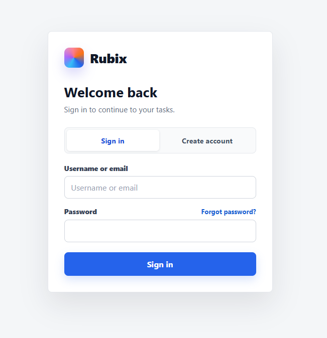
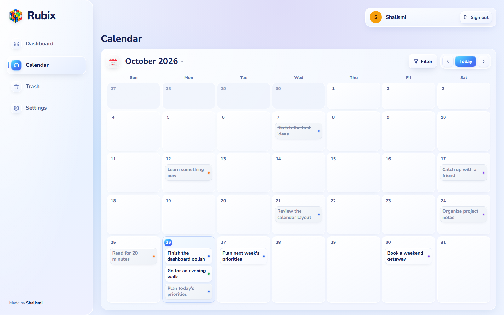
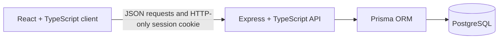

# Rubix

[](https://github.com/Shalismi/Rubix/actions/workflows/ci.yml)

Rubix is a full-stack task management application for planning work by date,
organizing it with reusable tags, and keeping each account's data private. It
combines a React interface with an Express API, PostgreSQL persistence,
server-backed sessions, automated tests, Docker, and continuous integration.

**[Open the live application](https://rubix-feqe.onrender.com)**

<p align="center">
  
</p>

## Features

### Task planning

- Create, edit, complete, and delete tasks with due dates.
- Separate past-due, today, upcoming, and completed task sections.
- Search tasks and preserve each account's collapsed section preferences.
- Track consecutive days with at least one completed task.
- View tasks on a full monthly calendar and jump from calendar entries to the
  matching dashboard task.
- Move deleted tasks into Trash, restore them, or permanently delete them.
- Automatically remove tasks after 30 days in Trash.

### Tags and organization

- Create reusable account-owned tags with custom colors.
- Assign multiple tags while creating or editing a task.
- Filter dashboard, calendar, and Trash results by tag.
- Reorder tag priority or disable priority-based ordering.
- Sort deleted tasks by their task date or deletion date.

### Accounts and recovery

- Register and sign in with a username and password.
- Add an optional email address and use it as a sign-in identifier.
- Keep tasks, tags, sessions, and interface preferences isolated per account.
- Change passwords while signed in and revoke other active sessions.
- Recover an account with a one-time recovery code when email delivery is not
  configured.
- Validate strong passwords with uppercase, lowercase, number, and length
  requirements.

### Delivery and quality

- Persist application data in PostgreSQL through Prisma.
- Run the frontend and API from one Render web service in production.
- Reproduce the production build locally with Docker Compose.
- Validate client, server, database, and Docker behavior with GitHub Actions.
- Protect authentication routes with request validation and rate limiting.

## Screenshots

### Authentication

<p align="center">
  
</p>

### Calendar

<p align="center">
  
</p>

## Architecture



In production, Express serves both the compiled React application and the
`/api` routes from one origin on Render. Prisma connects the API to the
PostgreSQL database hosted by Supabase. This avoids cross-site production
cookies and keeps deployment understandable as one web service plus one
database.

## Technology

| Area | Tools |
| --- | --- |
| Client | React 19, TypeScript, Vite, CSS |
| Server | Node.js 24, Express 5, TypeScript |
| Database | PostgreSQL 18, Prisma ORM |
| Authentication | Argon2 password hashing, database sessions, HTTP-only cookies |
| Testing | Node test runner, integration tests, ESLint, TypeScript |
| Infrastructure | Docker, Docker Compose, GitHub Actions |
| Hosting | Render web service, Supabase PostgreSQL |

## Technical Decisions

- **Server-backed sessions:** the browser receives a random session token in an
  HTTP-only cookie, while PostgreSQL stores only its SHA-256 fingerprint.
- **Account-owned records:** every task and tag query is scoped to the signed-in
  user so one account cannot access another account's data.
- **Committed migrations:** Prisma migration files make database changes
  repeatable locally, in CI, and during deployment.
- **Single production origin:** Express serves the React build and API together,
  which simplifies cookie security and production configuration.
- **Multi-stage Docker build:** build tools stay out of the final runtime image,
  reducing its size and limiting unnecessary production dependencies.
- **Recovery without email:** a single-use recovery code provides a testable
  password-reset path while the portfolio project does not use a paid email
  delivery service.

## Run With Docker

Docker is the quickest way to run the complete application with an isolated
database. Docker Desktop must be running.

```powershell
docker compose up --build
```

Open `http://localhost:8080`.

The Compose stack contains three services:

- `database` runs PostgreSQL and stores its data in a named Docker volume.
- `migrations` applies committed Prisma migrations, then exits successfully.
- `app` runs the compiled React client and Express API.

Stop the stack while preserving its database:

```powershell
docker compose down
```

Delete the Docker database and start fresh:

```powershell
docker compose down --volumes
```

The Docker database is separate from PostgreSQL installed on the computer and
from the production Supabase database.

## Run For Development

### Prerequisites

- Node.js 24
- PostgreSQL
- npm

Create an empty PostgreSQL database named `rubix`, then install dependencies
from the repository root:

```powershell
npm.cmd ci --prefix client
npm.cmd ci --prefix server
```

Create the local server configuration and replace the password placeholder in
`server/.env` with the local PostgreSQL password:

```powershell
Copy-Item server/.env.example server/.env
```

Generate the Prisma client and apply the committed migrations:

```powershell
npm.cmd run db:generate --prefix server
npm.cmd run db:migrate:deploy --prefix server
```

Start the API:

```powershell
cd server
npm.cmd run dev
```

In another terminal, start the React client:

```powershell
cd client
npm.cmd run dev
```

Open `http://localhost:5173`. The API runs at `http://localhost:5000`.

## Environment Variables

| Variable | Used by | Purpose |
| --- | --- | --- |
| `DATABASE_URL` | Server | PostgreSQL connection string. This is a secret. |
| `CLIENT_ORIGIN` | Server | Browser origin allowed to send authenticated requests. |
| `NODE_ENV` | Server | Enables development or production behavior. |
| `PORT` | Server | API listening port; defaults to `5000`. |
| `COOKIE_SECURE` | Server | Local Docker override; normally left unset. |
| `VITE_API_URL` | Client | API address for separate local frontend development. |

Local secrets belong in `server/.env`, which Git and Docker ignore. The tracked
`server/.env.example` contains placeholders only. Variables beginning with
`VITE_` are included in browser code and must never contain secrets.

## Tests And CI

Run the same main checks locally:

```powershell
npm.cmd run lint --prefix client
npm.cmd run build --prefix client
npm.cmd test --prefix server
docker compose config --quiet
docker build --target runtime --tag rubix:check .
```

The server integration suite creates a separate `rubix_test` database, tests
authentication and user-owned task flows, and removes that database afterward.
It does not change development data.

GitHub Actions runs three independent jobs for pushes and pull requests:

1. **Client checks:** installs dependencies, lints, and creates a production
   build.
2. **Server checks:** starts temporary PostgreSQL, generates Prisma, runs the
   integration suite, and builds the API.
3. **Docker checks:** validates `compose.yaml` and builds the production image.

CI verifies the project but does not deploy it or publish a Docker image.

## Production Deployment

Rubix deploys as one Render web service with these settings:

- Build command: `npm run render-build`
- Start command: `npm start`
- Health check: `/api/health`
- Root directory: blank

Render stores `DATABASE_URL` and `NODE_ENV=production` as environment
variables. Supabase provides the production PostgreSQL database. Render applies
the committed migrations during its build and automatically redeploys after a
successful push to `main`.

## Security Notes

- Passwords are hashed with Argon2 and are never stored as readable text.
- Session and verification tokens are random; only SHA-256 fingerprints are
  stored in PostgreSQL.
- Session cookies are HTTP-only, same-site, and secure over production HTTPS.
- Authentication and recovery endpoints use rate limiting.
- Server-side validation limits usernames, passwords, dates, tags, and request
  body size.
- Database access is scoped to the authenticated account.
- Local `.env` files and production credentials are excluded from Git and
  Docker builds.

## Current Status

The core account, task, tag, streak, calendar, Trash, persistence, testing, and
deployment flows are implemented. Real email delivery is intentionally
disabled. Optional email sign-in works, while verification and password
recovery use local/test flows and recovery codes.

## Project Structure

```text
Rubix/
|-- client/                 React application
|   `-- src/features/       Auth, settings, tags, tasks, and streak UI
|-- server/                 Express API and database layer
|   |-- prisma/             Schema and migration history
|   |-- src/features/       Auth, tags, tasks, and Trash logic
|   `-- tests/              API integration suite
|-- docs/screenshots/       README images
|-- .github/workflows/      Continuous integration
|-- Dockerfile              Production image recipe
|-- compose.yaml            Local app, database, and migrations
`-- PROJECT_STRUCTURE.md    Detailed source-code map
```

See [PROJECT_STRUCTURE.md](PROJECT_STRUCTURE.md) for a file-by-file guide.
