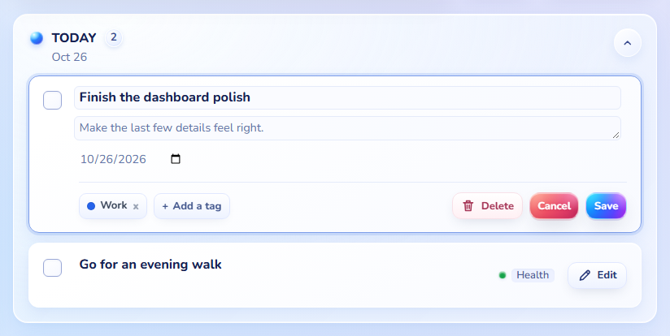
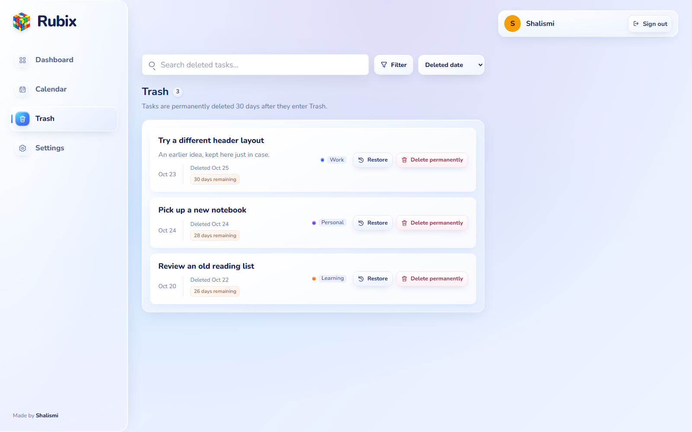

# Rubix

[](https://github.com/Shalismi/Rubix/actions/workflows/ci.yml)

Rubix is a personal task planner for organizing your day, planning ahead, and
keeping track of your progress. It brings tasks, colorful tags, a calendar,
and a daily streak into one place.

**[Try Rubix](https://rubix-feqe.onrender.com)** · Made by [Shalismi](https://github.com/Shalismi)


## What you can do

- **Manage tasks:** add a title, description, date, and tags. Edit a task right
  in its card and check it off when you're done.
- **Plan your day:** see past-due, today, upcoming, and completed tasks in
  separate sections. Collapse sections you don't need.
- **Organize with tags:** create colored tags, filter tasks, and set a tag
  priority order to arrange tasks within the same day.
- **Find things quickly:** search active, completed, and deleted tasks.
- **Use the calendar:** view a full month, jump to a month or year, filter by
  tag, and open a task from its calendar entry.
- **Track your streak:** see how many consecutive days you've completed at
  least one task, plus your activity this week.
- **Recover deleted tasks:** restore tasks from Trash or delete them
  permanently. Tasks in Trash are removed after 30 days.
- **Make it yours:** choose Nunito, Pilcrow Rounded, or Poppins. Your font and
  collapsed sections are remembered in your browser for your account.
- **Keep your own account:** sign in with a username or optional email, change
  your password, and use a saved recovery code to reset a forgotten password.
- **Navigate normally:** use Back and Forward, bookmark a section, or refresh
  without returning to the dashboard.

## Screenshots

Captured from the current interface with example tasks.

<details>
  <summary>Calendar</summary>


</details>

<details>
  <summary>Task editing and tags</summary>



</details>

<details>
  <summary>Trash</summary>



</details>

<details>
  <summary>Sign in</summary>

<p align="center">
  
</p>

</details>

## Built with

| Area | Tools |
| --- | --- |
| Frontend | React, TypeScript, React Router, Vite, CSS |
| Backend | Node.js, Express, TypeScript |
| Database | PostgreSQL, Prisma |
| Accounts | Argon2 password hashing, server sessions, HTTP-only cookies |
| Checks | Node test runner, Playwright, ESLint, TypeScript, GitHub Actions |
| Hosting | Render, Supabase, Docker |

The React app talks to an Express API, which stores each account's tasks and
tags in PostgreSQL. In production, the app and API run together on Render,
with the database hosted on Supabase. API requests check the signed-in account
so each person can access only their own data.

Password recovery uses a one-time recovery code. Email delivery is not configured.

## Run locally

With Docker Desktop running:

```sh
docker compose up --build
```

Open [localhost:8080](http://localhost:8080). Docker starts the app, database,
and migrations together.

For setup without Docker, environment variables, testing, and deployment,
see the [development guide](docs/DEVELOPMENT.md).

## Checks

```sh
npm run lint --prefix client
npm test --prefix client
npm run build --prefix client
npm exec --prefix client -- playwright install chromium
npm run test:e2e --prefix client
npm test --prefix server
```

The browser checks cover navigation, refresh, and account flows with example
API responses. The server tests use a separate test database. GitHub Actions
also checks the Docker build.

See the [project structure](PROJECT_STRUCTURE.md) for a guide to the source code.
